# 海岚 ERP 业务逻辑图

依据当前代码整理，供组内讨论、开发和联调使用。图片是业务记忆图；下方 Mermaid 图给出准确的单据关系与状态条件。首期范围是单工厂、单仓库、B2B 服装业务；一个订单可有多个款式和色码，一个订单款式对应一个工单。

## 1. 主业务闭环

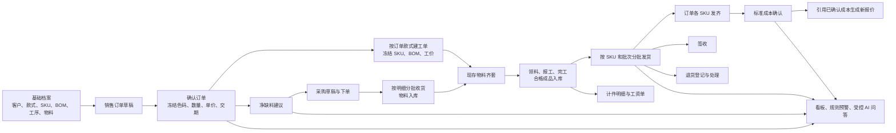

**关键区别：**采购建议考虑已下单未收货的在途量，但工单领料只认现存库存。成本可以先试算；确认必须等工单完工且该订单款式全部发齐。签收是出货单的后续状态，与“发齐”分别记录。

## 2. 接单与备料

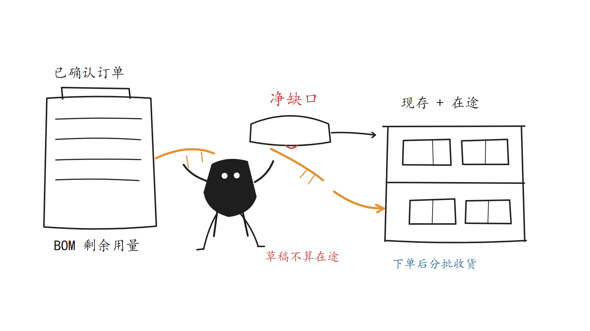

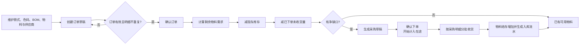

净缺口 = 活动订单 BOM 剩余需求 - 现存库存 - 已下单未收货数量；订单需求先扣已领料。采购草稿不计入在途，部分收货后只把未收部分算在途。收货不能超过采购明细的未收量，重复 `requestKey` 不重复入账。

## 3. 工单、库存与人事

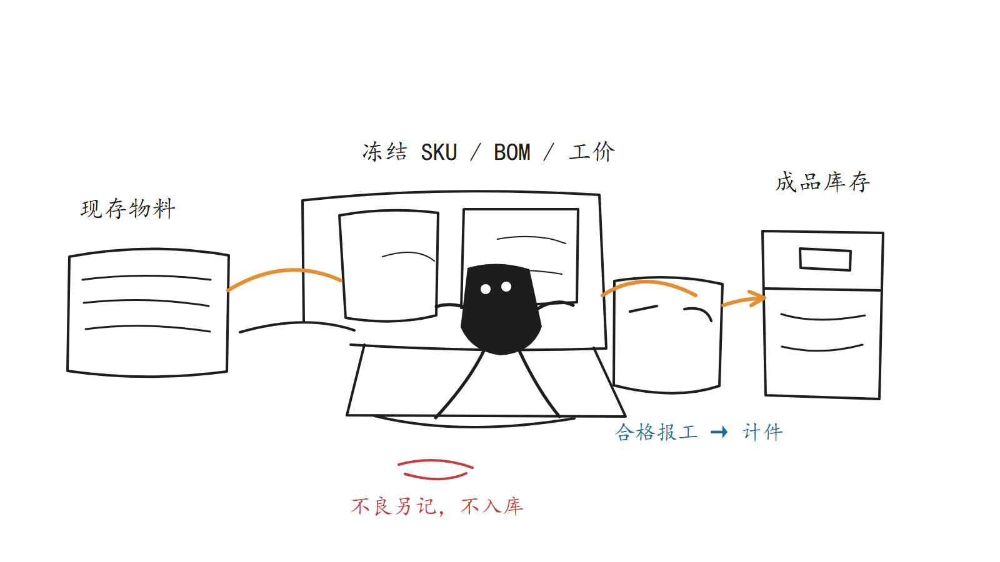

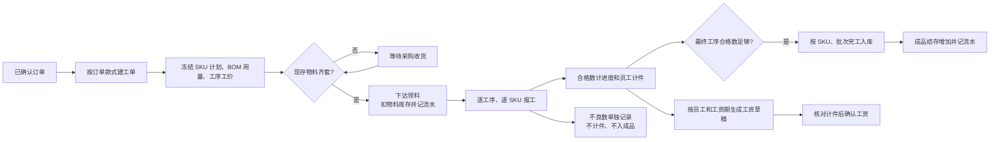

领料不能使用在途量；工序合格数不能超过 SKU 计划量或上一工序合格数。完工入库量不能超过最终工序累计合格数及冻结计划数。报工产生的内部员工计件记录供工资单汇总；确认后的工资期不能补录报工。采购收货、领料、完工、发货、退货回库和盘点差异都留下库存流水。

## 4. 分批出货与退货

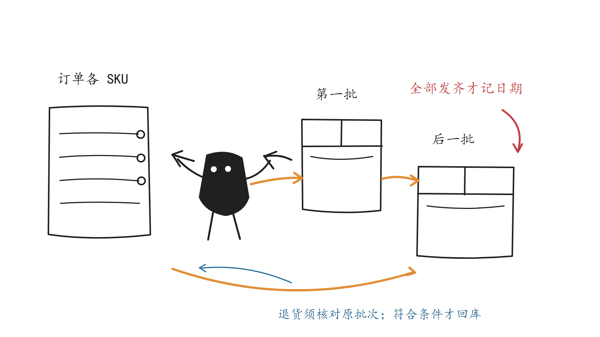

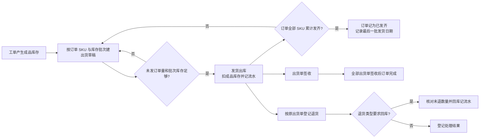

部分发货不等于已发齐；不能超订单 SKU 未发量，也不能扣成负库存。退货按原出货的 SKU、批次和剩余可退数量核对；符合回库条件时才增加库存。当前退货处理不会自动创建换货发运，也不会冲回已经确认的标准成本。

## 5. 标准成本与下一次报价

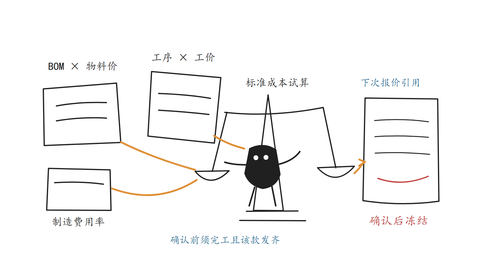

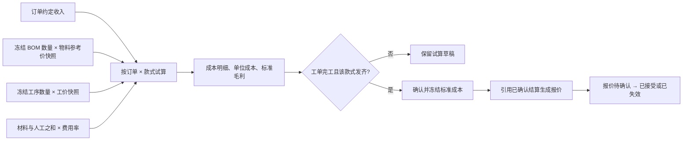

试算草稿可重算；已确认结算不可覆盖。这里是**标准成本**，不是实际领料成本、实发工资或退款后的净利润。报价引用的是已确认结算的成本快照，并保存来源。

## 6. 看板、预警与 AI

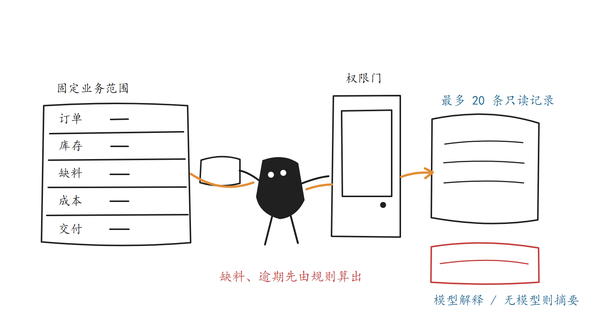

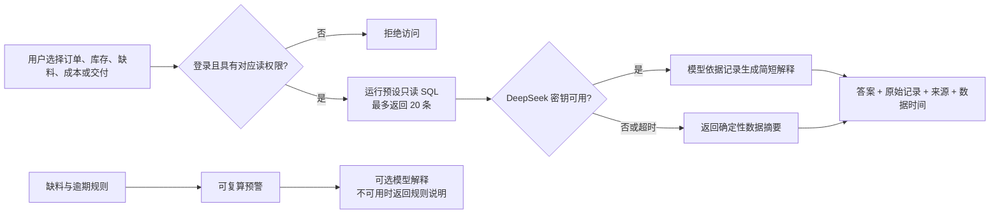

ERP 业务问答不是 RAG，也不会让模型生成 SQL 或执行单据动作。查询范围固定为订单、库存、净缺料、款式成本、发齐准交率五档，先校验工作台权限再按范围映射业务读权限，预设只读 SQL 最多返回 20 条。预警先由业务 SQL 规则计算，当前代码提供缺料和逾期未发齐两类。模型不可用或超时时降级为规则摘要（`modelUsed=false`），前端只渲染真实接口数据，不再有浏览器内的模拟数据分支。

## 7. 岗位接力

| 岗位 | 主要接力点 |
| --- | --- |
| 销售 | 客户、报价（新建/编辑/成交/转订单）、订单、交付跟踪、出货与退货 |
| 计划员 | 主数据维护、净缺料、采购建议、采购下单与收货、工单准备 |
| 仓管员 | 采购收货、库存结存与流水、领料、成品和出退货、库存调整 |
| 生产主管 | 工单、工序派工、领料、工序报工、完工入库、退料 |
| 人事 | 员工档案、计件核对、工资单生成（单条/批量）、确认与查询 |
| 财务 | 成本试算与确认、资金账户、应收应付、收付款登记与确认、会计期间结账、工资发放 |
| 厂长 | 经营看板、采购审批通过/驳回、资金只读、交付风险与授权范围内的业务问答 |
| 管理员 | 平台用户、角色、权限与全流程维护 |

所有岗位使用同一网址。工作台和导航随角色变化，真正的数据与操作权限由后端校验；权限不足返回 HTTP 200 + 响应体 `code=403`。业务动作的 `requestKey`、状态更新和库存/计件副作用在事务中处理，并发、权限与对账已由 `sql/self_check.sql`（29 项）、`p2`（9 项）、`p3`（15 项）、`p4`（7 项）覆盖。

主要代码依据：[订单服务](../backend/myfactoryai-manufacturing/src/main/java/net/factoryopen/myfactoryai/erp/service/ErpOrderService.java)、[采购服务](../backend/myfactoryai-manufacturing/src/main/java/net/factoryopen/myfactoryai/erp/service/ErpPurchaseService.java)、[工单服务](../backend/myfactoryai-manufacturing/src/main/java/net/factoryopen/myfactoryai/erp/service/ErpWorkOrderService.java)、[出退货服务](../backend/myfactoryai-manufacturing/src/main/java/net/factoryopen/myfactoryai/erp/service/ErpShipmentService.java)、[成本服务](../backend/myfactoryai-manufacturing/src/main/java/net/factoryopen/myfactoryai/erp/service/ErpCostService.java)、[ERP AI 接口](../backend/myfactoryai-admin/src/main/java/net/factoryopen/myfactoryai/web/controller/erp/ErpAiQuestionController.java)。
